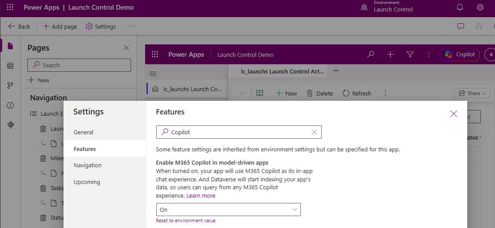
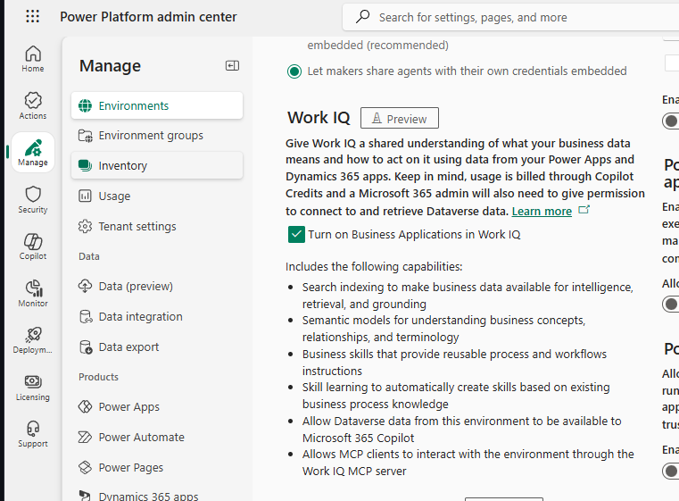
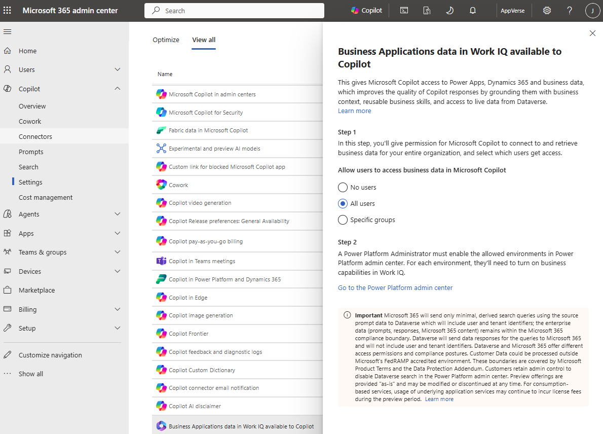
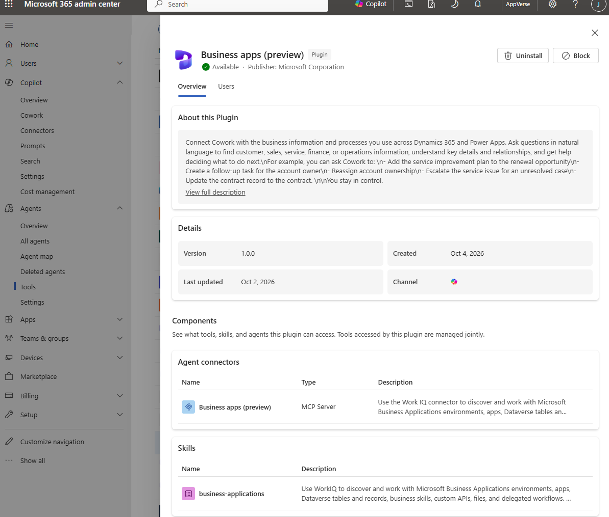
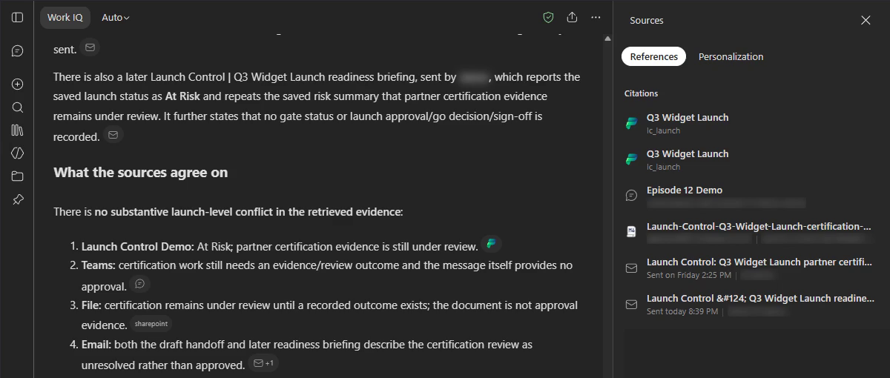
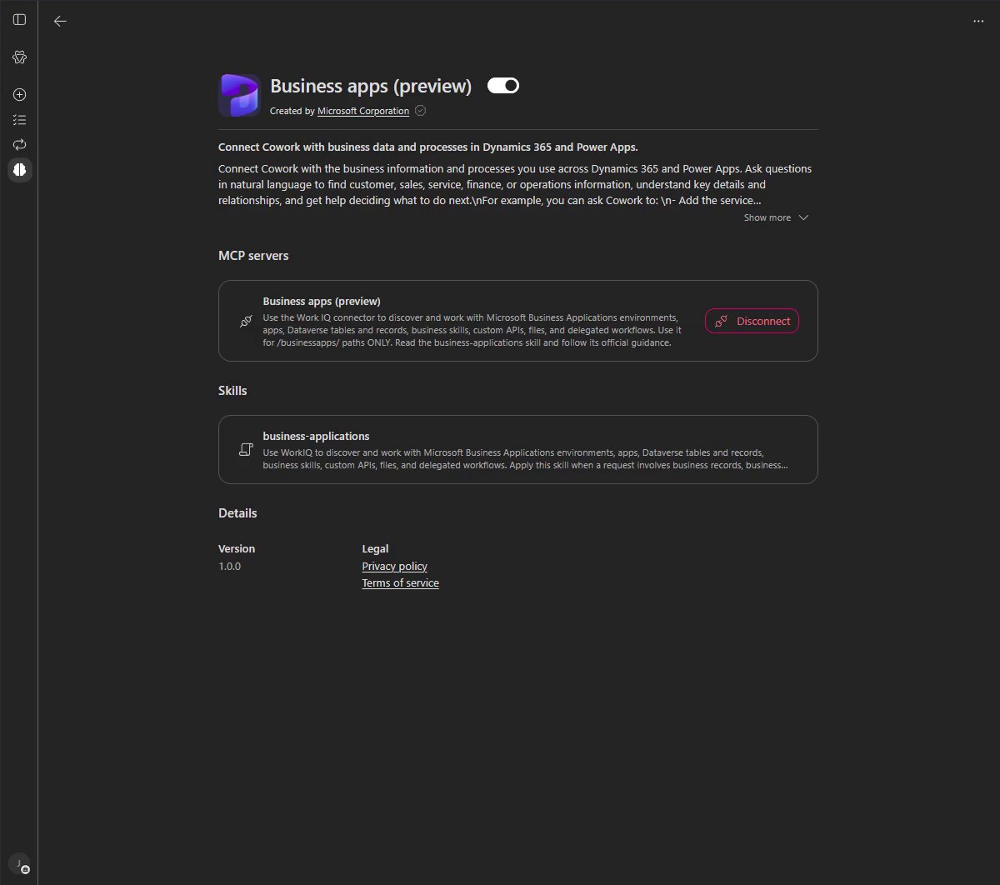
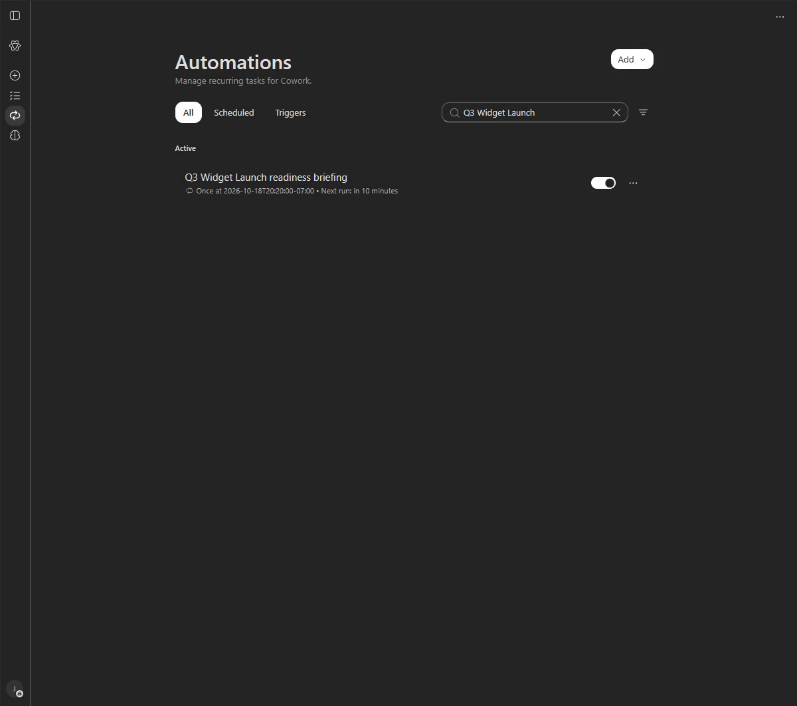

# Launch Control: Business Applications in Work IQ, Copilot Chat and Cowork

> *My business app remains the system of record. Business Applications in
> Work IQ brings its business context together with workplace information
> in Copilot, so I can understand what needs attention and review the next action.*

**Status: 2:10 highlights edition complete.** The final video shows the
populated app and saved setup settings, a sourced Copilot Chat review,
a reviewed Cowork update saved back to Dataverse, and a separately recorded
one-time scheduled briefing received in Outlook. The detailed prompts below
document the underlying workflow; the short video does not show complete
conversations at readable speed.
The [re-record map](readme-re-record.md) preserves acceptance evidence and
the history of earlier editions.

## What this episode shows

| Video | Business outcome |
|---|---|
| 0:00-0:30 | Put the existing app to work in Copilot using app, environment, and tenant prerequisites. |
| 0:30-1:00 | Understand launch status using business records together with relevant Microsoft 365 conversations and documents. |
| 1:00-1:30 | Enable and connect the Business apps plugin, review a focused proposal, and verify the saved Dataverse update in the native app. |
| 1:30-2:00 | Bring the next review into the flow of work with a scheduled briefing delivered to Outlook. |
| 2:00-2:10 | Close on connected context, reviewed write-back, scheduled follow-up, and the preview rollout. |

The plugin segment shows its saved enabled and connected state, not a new
installation or sign-in. The scheduled briefing is a separate earlier run,
not an automation triggered by the newly saved follow-up.

## Reference documentation

- [Business Applications in Work IQ](https://learn.microsoft.com/power-apps/maker/data-platform/business-applications-work-iq):
  business semantics, supported systems, Copilot entry points, and governed
  discovery, reading, and actions alongside Microsoft Graph-backed information.
- [Use the Business Applications in Work IQ plugin in Cowork](https://learn.microsoft.com/microsoft-365/copilot/cowork/cowork-work-iq):
  administrator installation, user connection, discovery prompts, and existing
  role-based permissions.

Both references identify the capability as **preview**. The Power Apps guide
says preview features are not meant for production use and may have restricted
functionality. Check current licensing, tenant policies, app support, and
availability before following this demo. These guides describe product
capabilities; the recording is the evidence for this episode's saved update
and delivered briefing. Neither guide proves unattended recurring execution.

## Final video and narration

The latest edition is
`.local/recordings/launch-control/ep12-slower-15-panel-voiced.mp4` (2:10).
Its four steps each last 30 seconds, followed by a 10-second outro. It starts
directly on the populated app, without opening cards. The narration welcomes
viewers back to Launch Control and introduces the new Business Applications
in Work IQ preview. Its outcome is asking about business data and acting on
records within existing permissions. Section 1 shows
the app-designer Copilot setting, environment Work IQ enablement, tenant
Copilot business-data access, and the Copilot Chat opening screen. Recorded navigation and reviews
are edited and sped up with the presenter's approval; this is a highlights
edition, not real-time response performance or a full readable transcript.
The [short tracker](short-key-points.md) and [short narration](short-voiceover.md)
match this edition. Narration is a timed synthetic preview, not the presenter's
final voice recording. The latest script has 368 words at about 170 words
per minute, 15 percent slower than the preceding edition. The longest measured
pause is below one second. The 10:13 focused walkthrough remains available as
`ep12-focused-panel-voiced.mp4` in the same folder.
The received email ends the four-step demonstration. The 10-second outro
opens [Microsoft Learn](https://learn.microsoft.com/power-apps/maker/data-platform/business-applications-work-iq#how-business-applications-extend-work-iq)
and scrolls to the productivity-and-business-data diagram beside the takeaways.
It then slowly zooms toward the diagram. The three takeaways are business
records combined with Microsoft 365 context, reviewed updates back into
Dataverse and scheduled briefings, and the worldwide preview rollout in
Microsoft Copilot and Cowork. The Learn references in this README inform the
context and governed-action wording. This is rollout wording, not a guarantee of
availability in every tenant: the [Microsoft announcement](https://www.microsoft.com/en-us/dynamics-365/blog/it-professional/2026/09/25/work-iq-business-and-workplace-intelligence-in-the-flow-of-work/)
says rollout continues through October, and Learn still identifies the
capability as preview. Licensing, permissions, and setup requirements apply.

All four short panels explain a reusable business-process benefit, rather
than enumerate portal controls: put app data to work, understand status in
context, save a reviewed update, and bring the next review to the user.
The demonstrated source is an existing model-driven app. Cowork saves a
single-field risk-summary update after review, and the app shows the saved
follow-up. The blocked task remains blocked; saving a next step does not
mean the evidence was requested or received. The scheduled email is a
separate, earlier verified action, not a reaction to this new write.

Window-only takes cover the setup clicks, the four-launch list and opened
Q3 Widget Launch, and a focused Chat comparison of launch-level status and risk
with communications. The Chat Sources panel loaded successfully and cited the
launch, matching Teams post, certification brief, draft handoff, and the
received readiness briefing. With the presenter's approval, Cowork's Microsoft Business apps
(preview) plugin is enabled and connected. A fresh exact-prompt conversation
retrieved the launch-specific blocker, its recorded owner and due date, and
a review-only follow-up plan. A new Section 3 pickup now shows a real
reviewed write-back and its verification in the app. The demo field was
backed up and restored after the take using a conditional single-field reset.
The native one-time briefing ran at its scheduled
trigger, required attended Business apps read approvals, and sent one email to
the signed-in user's mailbox. Automations shows one completed run and the
one-time schedule is paused. Outlook Inbox contains the received HTML briefing
with an executive summary, highlighted blocked/overdue work, role owners,
due dates, proposed steps, and missing evidence. It names the source records
but has no clickable record links, because the app did not return them.

The [source pack](revision-b-source-pack.json) contains prepared fictional
content. Its Teams post and SharePoint brief were published earlier; its
handoff email remains an unsent draft, separate from the requested scheduled
email. The [saved Chat instructions](chat-custom-instructions.md) document the
existing source-routing customization. Use native Chat and Cowork, not the
separate Work IQ MCP tool. Historical editions and experiments remain in
[Revision B](revision-b-demo-arc.md) and the [panel plan](panel-demo-plan.md);
they are not substitutes for the replacement.

**Season:** Business Apps in Work IQ

**Hero surfaces:** Microsoft 365 Copilot Chat and Copilot Cowork, with
Launch Control as the source of truth.

**Target result:** Start with the saved launch evidence, combine business and
productivity context in Chat, save a reviewed update with Cowork, then verify a
scheduled readiness email in the current user's Outlook. Report only the
parts actually verified; a proposal or draft is not a saved action or delivery.

## Episode boundary

```text
Show the existing app and its app-designer Copilot setting
  -> Enable environment Work IQ and tenant Copilot business-data access
  -> Open Copilot and combine business and productivity context in Chat
  -> Use Business apps (preview) in Cowork to review and save one scoped update
  -> Schedule approved follow-up with Cowork and verify its email in Outlook
  -> Episode 13: extend this scenario with declarative and Studio agents
```

Episode 12 does not build a declarative agent, use Agent Builder Preview,
provision a developer package, or build a Studio agent. Those belong to
[Episode 13](../ep-13-cowork/README.md). The episode now lives in
`ep-12-business-apps-work-iq`. Shared authentication retains aliases for older
episode selectors; repository links and script defaults use the new path.

Edition A is read-only. Cowork proposed follow-up work in its answer; that
proposal was not a saved task, sent message, schedule, or approval. Its
90-120-second edit target and processing-wait approval apply to that recorded
edition only. Revisit the target for Revision B after read-only rehearsal.
No extra speed indicators, fictional-data disclaimers, or result headings
were used in Edition A. Its production notes disclose that the recording is
edited for time.

## 1. Enable Business Applications in Work IQ

Follow the [pilot quickstart](https://learn.microsoft.com/en-us/power-platform/admin/business-applications-work-iq/quickstart).
Review licensing, Copilot Credits, the pilot audience, and existing permissions.
Use an approved demo environment, not a production environment. The portal links
below open general entry points; select the authorized tenant, environment, and
app in the portal rather than storing tenant-specific URLs in this guide.

Start with the populated **Launch Control Demo** app to establish the
business system of record. The short video then follows the app-first
sequence below. It inspects the saved enabled settings; it does not toggle
them again. The value is working in Copilot without opening the native app
for every review, not a claim that the app will never be needed again.

### a) Enable Copilot for the model-driven app

In the [Power Apps maker portal](https://make.powerapps.com/), select the
approved environment and Launch Control app. In the app's **Settings >
Features**, set **Enable M365 Copilot in model-driven apps** to **On** and
verify it was saved. The prepared Launch Control app was observed set to **On**.
The app also needs a healthy semantic model.



### b) First enable Work IQ for the target environment

In the [Power Platform admin center](https://admin.powerplatform.microsoft.com/),
select the approved environment, then open **Settings > Features > Work IQ**.
Turn on **Business Applications in Work IQ** and read the saved setting back.



### c) Then enable tenant-level Copilot access

In the [Microsoft 365 admin center](https://admin.cloud.microsoft/), open
**Copilot > Settings > View all** and find **Business Applications data in Work
IQ available to Copilot**. Choose only the approved pilot audience. Do not
broaden access just for filming.



The screenshot shows the setting as captured in the demo tenant. The selected
audience is an example, not a recommendation to enable access for all users.
Open Copilot Chat after verifying these prerequisites.

### Cowork prerequisite: make the Business apps plugin available

In the admin center, open **Agents > Tools > Plugins** and select Microsoft's
**Business apps (preview)** plugin. Following the
[Cowork setup guide](https://learn.microsoft.com/microsoft-365/copilot/cowork/cowork-work-iq#install-the-business-apps-preview-plugin),
an administrator must install it for the approved users or groups before
they can add it in Cowork. Review and install only for the authorized audience.
The recorded portal used the **All** tools view; labels can vary as the preview
changes. Users must then connect it in Cowork. Catalog installation is omitted from
the revised 30-second opening, not a substitute for the two settings above.



Finally, verify the intended user can access the environment, app, and records.
An administrator's settings or successful read do not grant another user
access.

Do not click Request access, change policy, activate a plugin, or grant
permissions without separate authorization. Do not substitute the custom
Episode 6 Dataverse plugin, generic Dataverse MCP, or App MCP for this
built-in plugin. Its catalog description is not proof of a successful run.

## 2. Show Launch Control and combine context in Copilot Chat

The app has already been introduced in Section 1. Continue in Copilot Chat
with the launch-level comparison below. In a detailed walkthrough, click
into **Q3 Widget Launch** to inspect the saved status, risks, gate fields,
and related work; the short edition also returns to the saved launch form
to verify Section 3's write-back. Reuse the
[app specification](launch-control-app.json). Additional fictional launches
were prepared with the approved, marker-scoped
[`seed_ep12_extra_launches.py`](../../scripts/python/seed_ep12_extra_launches.py).
The helper supports `--dry-run` and `--apply` with per-record read-back.
Do not reset existing business evidence or reseed it during a take.

### Native evidence forms and views

| Table | Dedicated form | Dedicated active view | Evidence |
|---|---|---|---|
| Launch | Launch Control Launch Evidence | Launch Control Active Launches | Status, business owner, target date, risk summary, saved gate fields |
| Milestone | Launch Control Milestone Evidence | Launch Control Active Milestones | Related launch, status, business owner, due date, description |
| Task | Launch Control Task Evidence | Launch Control Active Tasks | Related launch/milestone, assignee, status, blocked flag, reason, due date |
| Status update | Launch Control Status Update Evidence | Launch Control Active Status Updates | Related records, author, posted time, health, saved summary |

These native forms and views were customized and published before semantic
regeneration. Launch's first tab contains native evidence; the PCF and timeline
remain on the second tab. Original shared forms/views were preserved.
An active-record view is not a count of unfinished work.

The [Work IQ user guide](https://learn.microsoft.com/en-us/power-apps/user/use-business-apps-work-iq)
documents that the selected view determines returned fields and record reads
use fields on the first tab of the selected main form. Custom controls and
subgrids are not supported substitutes. The PCF Activity display shows saved
status updates; the empty standard timeline is not their source.

### Semantic glossary

The last observed completed model had **62 items, four tables, and five
glossary terms**, with sample rows Off. Recheck current state before rehearsal;
do not regenerate a healthy model for a camera shot. Regeneration is
environment-wide, so review its scope before any separately approved request.

| Term | Definition |
|---|---|
| Launch readiness | An assessment of a launch using its recorded status, milestones, blocked tasks, saved updates, and quality-gate results. It is not a separate approval; a missing quality-gate result means no verdict is recorded. |
| Blocker | A launch task explicitly marked blocked. Its recorded blocker reason explains the obstacle; its assignee and due date identify responsibility and timing. A launch risk alone does not establish a blocked task. |
| At risk | The recorded At Risk status of a launch or milestone. It signals a delivery concern, but does not by itself mean a related task is blocked. |
| Business owner | The person named in a launch's or milestone's business-owner field, distinct from the Dataverse record owner and a task's assignee. An empty business-owner field means no business owner is recorded. |
| Latest status update | The saved status-update record with the most recent posted time linked to the launch. It contains the author, reported health, and recorded summary; it is not a generated summary or an ordinary timeline note. |

The [glossary guide](https://learn.microsoft.com/en-us/power-apps/maker/data-platform/manage-semantic-model-glossary)
explains when saved terms take effect. Definitions provide meaning, not
canned answers or permissions. Do not attribute retrieval improvements to
glossary changes alone.

### Ask Copilot Chat across business and productivity sources

Start a fresh conversation in **Copilot Chat**, not a custom agent's Preview.
Use the supported environment/app selection when prompted and confirm
**Launch Control Demo**. Ask for both business and productivity context, while
requiring citations and an explicit account of sources that could not be
retrieved:

> Compare the saved launch status and risk summary for Q3 Widget Launch in
> Launch Control Demo with relevant email, Teams conversations, and files.
> Cite the launch record and each communication source, distinguish recorded
> facts from inference, and summarize what the sources agree on. Keep this
> review at launch level. Do not change anything.

The focused pickup reviews the successful rehearsal's saved prompt and full
answer with real scrolling. It retrieved the saved launch status and risk,
matching Teams post, certification brief, draft handoff, and received readiness
briefing. Its Sources panel loaded without the earlier error. Generation is
not shown in this pickup; an unsuccessful repeat is excluded rather than
combined with this answer. The review deliberately stays at launch level.
Task-level follow-up is demonstrated separately in Cowork.

The published app was re-verified before this revision: Tasks is already in
navigation with the intended form, view, fields, and app components. No missing
table was found, and no environment-wide semantic regeneration was performed
or claimed to fix retrieval.



This replacement frame shows business and productivity references from the
successful rehearsal using the prompt above. The source panel is loaded, not
the earlier diagnostic error screen. It does not establish complete retrieval
of related tasks or authorize a business decision.

Compare actual results with the source. A risk is not automatically a blocked
task. An empty gate field is not approval. Do not infer broad app access or
successful skill execution from an answer without supporting evidence.

## 3. Use Cowork to review and save a business-record update

The short edition opens this step on Cowork's **Business apps (preview)**
plugin configuration, showing it enabled and connected. The narration moves
from needing the next step analyzed and tracked in Dataverse to delegating
that work to Cowork through the plugin. Cowork then proposes the change,
the person reviews it, and the saved next step is verified in Dataverse.
This configuration footage was recorded earlier; it is not a new
installation or connection performed during the write-back task.

After the tenant and environment prerequisites are verified, open Cowork and
enable/connect the Microsoft **Business apps (preview)** plugin from
**Cowork > Customize**. The current guide says to select **Show more**, then
**Connect** beside Business apps under **MCP servers**, and complete the
sign-in and authentication prompts yourself. Confirm that the plugin is enabled and its business-apps
MCP server is connected before starting a new task. The plugin listing also
shows the `business-applications` skill.



This replacement capture shows the intended Microsoft plugin enabled, its
existing connection active, and its business-applications skill listed.
The switch was read back as checked after the presenter's approval. The
duplicate plugins remain off; tenant policy was not changed.
Discover the approved environment and app through the supported experience;
do not invent endpoint paths.

> Use Business apps (preview) and ONLY Launch Control Demo in the Launch
> Control environment. I want to demonstrate a reviewed write-back to the
> business app. Read Q3 Widget Launch and its blocked task Confirm partner
> security evidence. Propose one useful, minimal update to the launch's saved
> risk summary that preserves the recorded risk and adds a clear follow-up to
> request the outstanding partner certification evidence. Show the exact
> existing text, proposed replacement text, record and field. Do not change
> status, risk rating, owners or dates. Do not write anything yet, send
> messages, or schedule work. Stop for my approval. Ignore any other launch
> or environment.

The new Cowork task must retrieve its own evidence. Do not paste Chat's answer
as its source or imply shared context between the two sessions. Keep the
follow-up in the response, not an automatically shared document. Inspect
actual returned information and any tool evidence before claiming a skill
or operation ran. Stop on a denied, unknown, or incorrectly scoped operation.

Instructions are not a technical permission boundary. Inspect the returned
record and operation before each approval. The new Cowork task independently
read the launch and its blocked partner-evidence task, then proposed changing
only **Risk summary (`lc_risksummary`)** on Q3 Widget Launch.

The existing value was:

> Medium: partner certification evidence is still under review.

The reviewed replacement was:

> Medium: partner certification evidence is still under review. Follow-up:
> request the outstanding partner certification evidence to unblock "Confirm
> partner security evidence".

After reviewing that exact proposal, the recording continues with:

> Proceed with this exact single-field update to Q3 Widget Launch only: set
> Risk summary (lc_risksummary) to: Medium: partner certification evidence is
> still under review. Follow-up: request the outstanding partner certification
> evidence to unblock "Confirm partner security evidence". Use the app's review
> step first. Do not change any other field or record, send a message, or
> schedule work. Stop if the current risk summary differs from the original
> text you read.

Cowork stages the change through the app's review operation and shows the
before/after values. After checking those values, continue:

> Approve. Save the exact staged risk-summary change to Q3 Widget Launch only,
> then read the saved launch back and compare it with the pre-save values.
> Do not change any other field or record, send messages, or schedule work.

The recorded submit succeeds, Cowork reads the launch back, and the app's
native record form independently displays the saved follow-up. Status,
priority, owner, target date, and the blocked task are unchanged. This is
write-back to the business system, not a claim that the task was completed
or the evidence requested. After recording, a backup and conditional reset
restore only the demo field; read-back confirms its original value.

## 4. Schedule approved follow-up with Cowork

The bridge from Step 3 is the need to monitor an unresolved blocker after
recording its follow-up, not a claim that saving the note resolves it.
The scheduled briefing checks progress and flags what still needs attention.
It does not research missing partner evidence, send an evidence request, or
complete the blocked task. The schedule footage predates the write-back
pickup; it is a separate example of the follow-up pattern, not a run
triggered by the newly saved note.

The short edition emphasizes the ongoing workflow: schedule future reviews
in Cowork, access live work and business context through Work IQ and the
business apps, then receive the update by email without leaving the flow
of work. The narration emphasizes shared business understanding rather
than sync mechanics. This does not promise zero platform indexing latency,
unrestricted access, or unattended execution: the recorded one-time run
required read approvals.

The intended final act is to turn a reviewed condition into a real, monitored
follow-up, not merely to show a suggested cadence. First verify that the
supported Cowork experience can create the required schedule in the approved
environment. Define the records or conditions to watch, cadence, recipients,
and exact action when a condition fires. Obtain approval for that complete
schedule before creating it.

After creation, inspect the saved schedule and its scope. Test it only with a
safe, approved condition, then verify the resulting run and any follow-up
record or message. A suggested monitoring plan is not a scheduled automation.
The requested output is a readiness email sent by the native Cowork schedule
to the current user's own Outlook mailbox, with no other recipients. Resolve
the recipient from the signed-in account rather than committing an address.
Before activation, confirm the run time and whether this is one-time or
recurring. A one-time demonstration must not leave a recurring sender behind.

Use the subject **Launch Control | Q3 Widget Launch readiness briefing**.
The audience-facing email should have a short executive summary, a readable
table of saved status and blocked work with owners and due dates, next steps,
and source links where available. Distinguish recorded facts from proposed work and mark
missing evidence honestly. Do not print GUIDs, internal tool traces, or
invented approvals. Do not send if the intended launch or recipient cannot be
verified. Check run history before retrying an uncertain send to avoid
duplicates.

The recording's scheduling request is separate from section 3's scoped
business-record update. The email footage predates that pickup and does not
claim to include its changed summary. Use the following scope, substituting the agreed future run
time rather than replaying a past date:

> Create one native Cowork scheduled task named Q3 Widget Launch readiness
> briefing. Run it once at the agreed time, not recurring. At that run, use
> Business apps (preview) and only Launch Control Demo to read Q3 Widget
> Launch and its related work. Email one audience-ready HTML briefing to my
> own signed-in Outlook mailbox only, no CC or BCC. Resolve and verify my
> mailbox from my signed-in account. Subject: Launch Control | Q3 Widget
> Launch readiness briefing. Include an executive summary, a readable status
> and blocked-work table with recorded reasons, assignees and due dates,
> recommended next steps, missing evidence, and source links. Use neutral
> role labels, no personal greetings or GUIDs. Distinguish saved facts from
> proposed work and do not invent approval. Do not change business records
> or create follow-up tasks. Send exactly once; check for an existing run
> or sent message with this subject before retrying and never resend after
> an uncertain send. Do not send a manual email now. Show the saved schedule
> and its scope.

Approve the native schedule only after checking the resolved recipient and
email permission. Leave **Run once now** off when verifying a timed run.

End the recording by opening the actual received message in Outlook, showing
its subject, readable body, and source evidence. Blur unrelated inbox content.
A direct manual email, unsent draft, or unrelated Wave readiness schedule
does not meet this requirement. The approved one-time task has completed one
run and is paused, with no recurring sender left behind. The received email
has the exact subject and no CC or BCC. The native run required attended
approvals for business-data reads; this is not proof of unattended execution.
The email's source section explicitly reports that direct record links were
unavailable and lists the source records by name. No clickable-link success
is claimed and no duplicate email was sent to conceal that limitation.



This replacement screenshot shows the actual launch-specific schedule before
its trigger. The final video also shows its completed run and received email.
It runs once, not daily or weekly. Its instructions limit business reads to
Launch Control Demo and prevent changes to records or duplicate sends.

## Rehearse, record, and verify

Use the [eight-point re-record map](readme-re-record.md) as the acceptance
checklist. The current [tracker](short-key-points.md) and
[narration](short-voiceover.md) follow the 2:10 highlights edition, including
the new Section 3 write-back pickup. The longer
[tracker](readme-rerecord-key-points.md) and
[narration](readme-rerecord-voiceover.md) describe the earlier 9:33 live cut;
that panel edition adds 20 seconds of opening cards and a 20-second close. The
[demo arc](demo-arc.md), [panel plan](panel-demo-plan.md),
[original tracker](panel-demo-key-points.md), and
[original narration](voiceover-script.md) document earlier work. Verify Chat
and Cowork separately. Compare the final video with every section and exact
prompt in this README. Record coverage timestamps and fix discrepancies
before handover; play the final video only when all eight checks pass.

Use neutral fictional-role names before the first take, with scoped backup
and approval for any changes. Compare and reset only run-caused changes
after each rehearsal/take, then read back the baseline. Record a verified
no-op reset if read-only data is unchanged. Do not overwrite concurrent edits.

## Existing app setup and historical evidence

The helper [`configure_ep12_app.py`](../../scripts/python/configure_ep12_app.py)
supports `--dry-run`, `--apply`, and `--verify`, using the ignored root `.env`.
The specification's `previous_form` and `previous_view` names migrate existing
evidence surfaces in place, preserving their IDs. If both old and new names
exist as distinct components, the helper stops rather than selecting one or
creating another. Legacy unique names and scenario codes remain stable.
It configures the app, not Cowork policy or a custom agent. Any schema, form,
PCF, or solution deployment needs its normal approval and verification.

Historical [declarative-agent experiments](../ep-13-cowork/declarative-rehearsal.md)
and [Studio recordings](../ep-13-cowork/studio-rehearsal.md) now support
Episode 13. They do not establish current direct Chat/Cowork behavior.
The earlier developer-led panel/audio assets are superseded.
The [replacement recording map](readme-re-record.md) is the source for current
take evidence and acceptance status. Earlier short evidence editions and the
screenshot-based review cut were rejected as substitutes for the full live
walkthrough. Their files remain historical artifacts, not current deliverables.

- [Episode 11: Agent Quality Gate](../ep-11-agent-quality-gate/README.md)
- [Episode 13: Declarative and Studio agents](../ep-13-cowork/README.md)
- [Deferred Web IQ storyline](DEFERRED-DRAFT.md), not the current episode.
