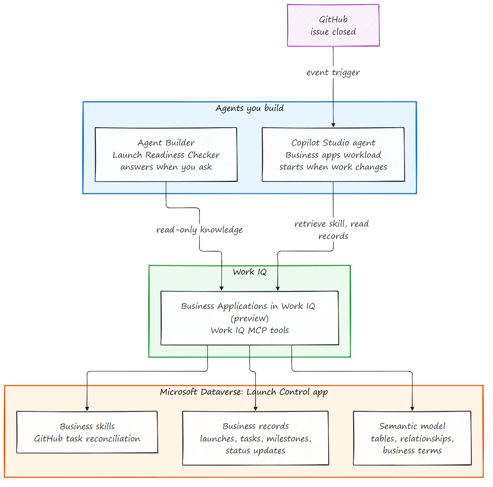

# Episode 13: Build agents on Work IQ

> *My team keeps asking the same question: are we ready to launch? Work IQ
> gives every agent I build the same business context, so a focused agent can
> answer it, follow how we work, and start when the work changes.*

## The hook

In [Episode 12](../ep-12-business-apps-work-iq/README.md), I brought my
business app into Copilot and reviewed an update with Cowork. This episode
treats Work IQ as the platform underneath the agents I build.

Agent Builder gives a repeatable launch question its own focused agent,
grounded in the Launch Control app through Business Applications in Work IQ.
A business skill keeps our review process beside the app. Copilot Studio adds
the Business apps workload to an agent built on Work IQ, then lets an event
start the review. The app remains the system of record, and each run is
checked for what it actually did.

> **Preview note:** Work IQ is generally available in Copilot Studio and runs
> on the GitHub Copilot harness with Copilot Credits. Its **Business apps**
> workload, Business Applications in Work IQ, and business skills are preview
> capabilities. Validate availability, licensing, permissions, and setup.
> Preview features are not meant for production use.

## The walkthrough: three acts

```text
Act 1     Focused agent  -> Ask about the launch anytime
Act 2     Business skill -> Teach the agent how we work, then add Business apps
Act 3     Event trigger  -> Let the work start the review, then check the run
Epilogue  Demo prep      -> See the launch ready to go
```

The recorded Studio run is a read-only Preview on one closed issue. The
ready answer follows a separate, approved update of the fictional records,
not the agent.

## Architecture: two agents, one platform



- **Agents on top.** Each agent has one job. The Agent Builder agent answers
  the launch question on demand. The Copilot Studio agent starts from a GitHub
  event and follows the reconciliation skill.
- **Work IQ in the middle.** Both agents get the same business context through
  Business Applications in Work IQ, so neither rebuilds it agent by agent.
- **Dataverse underneath.** The Launch Control app holds the business records,
  the semantic model that explains how they relate, and the business skill
  that describes how we work. Dataverse security applies to every answer.
  The app stays the system of record; changes need a person to confirm them.

## What the docs say about Work IQ as a platform

From [Add knowledge in Agent Builder: Dynamics 365 and Power Apps data](https://learn.microsoft.com/microsoft-365/copilot/extensibility/agent-builder-add-knowledge#dynamics-365-and-power-apps-data):

- Business Applications in Work IQ gives agents context from Dynamics 365 and
  Power Platform data and processes, within existing permissions and controls.
- An admin enables it in the Microsoft 365 admin center and for each Power
  Platform environment.
- The agent gets **read-only** access. You choose which apps it uses; without a
  selection, it queries every app the user can access.
- Dataverse security applies to every answer. People without access to a
  record get no response from it.

From [Work IQ in Copilot Studio](https://learn.microsoft.com/microsoft-copilot-studio/agents-experience/add-work-iq):

- Work IQ is the intelligence layer that grounds Microsoft Copilot and your
  agents: data, memory, and inference through Work IQ MCP tools.
- New agents on the GitHub Copilot harness get Work IQ by default, with all
  generally available workloads selected.
- **Business apps** is a preview workload. Turn on **Enable preview
  workloads** in the agent's Work IQ settings to add it.
- Use Work IQ, not legacy workload tools, which use a different harness and
  billing. Write operations are on by default, subject to your permissions
  and policies, so instructions alone are not a permission control.

## 1. Ask about the launch anytime

Open the **Launch Readiness Checker** draft in Agent Builder with the
[natural-language instructions](natural-language-instructions.txt). Under
Dynamics 365 and Power Apps knowledge, select **+** to see the business apps
Work IQ lists, and choose only **Launch Control Demo**. Then ask:

> What is the current status of Q3 Widget Launch, and what is blocking it?

Check the answer against the app's records. The recorded answer said the
launch was at risk: partner security evidence was still under review and the
release checklist was still in progress. A second starter lists the work behind it:

> Use the Launch Control Active Tasks view in Launch Control Demo to list the
> tasks for Q3 Widget Launch. Show each task's status, blocked flag, recorded
> blocker reason, assignee, and due date. Cite the source records and identify
> any fields you cannot retrieve.

## 2. Teach the agent how we work

What was missing is reconciliation: work closed in GitHub never reached the
matching Launch Control task. Author that process once as a business skill in the same Power Apps
environment as the app. The
[reconciliation skill](../../business-skills/github-task-reconciliation.md)
spells out the evidence to check, the record mapping, and when to stop. It is
guidance, not permission to change records.

Agent Builder answers when you ask. To react when work changes, build a
second agent in Copilot Studio on the same Work IQ platform:

1. In [Copilot Studio](https://copilotstudio.microsoft.com/), create a new
   agent. Agents on the GitHub Copilot harness get Work IQ by default.
2. Open the agent's **Work IQ** settings, turn on **Enable preview
   workloads**, and select **Business apps**. Keep only the workloads the
   agent needs.
3. In the agent's instructions, tell it to retrieve the reconciliation skill
   before acting, read the matching Launch Control records through Work IQ,
   and stop and report when something doesn't match.
4. Test it in Preview with one closed issue, then open the session history
   to confirm it retrieved the skill and which records it read.

A selected workload is configuration; check what the running agent can
actually use.

## 3. Let the work start the review

In the Studio agent,
[add an event trigger](https://learn.microsoft.com/microsoft-copilot-studio/agents-experience/authoring-add-event-trigger)
with the GitHub connector's issue-closed event, scoped to your repository, so
a change in the work starts the agent.
Then check the agent's session history for the tools it called and what it
read or changed. The recorded Preview run on one closed issue retrieved the
business skill first, then read Launch Control records through Work IQ. Its
prompt was read only, so it changed nothing. The Work IQ MCP server can also
prepare updates for a person to confirm.

## 4. See the launch ready to go

For the epilogue, the fictional records were updated with approval: four
tasks and three milestones Done, the launch On Track, and a new dated status
note. Asked again, the Agent Builder agent pulled the live status: On Track
with nothing blocking. No agent made that update, and it is not a real launch
approval.

## Verify what you build

Verify Agent Builder and Copilot Studio separately against the app's records,
not against each other's answers. Publishing, sharing, connections, writes,
and event tests each need their own approval. Neither a selected workload nor
one successful run proves an unattended business update.

The video's separate takes are not one continuous run, and response waits
were cut, so it is not a latency test.

## Cross-references

- [Episode 12: Business Applications in Work IQ](../ep-12-business-apps-work-iq/README.md)
- [Episode 15: Work IQ API and Developer Tools](../ep-15-workiq-api-devtools/README.md)

## Reference documentation

- [Add knowledge in Agent Builder: Dynamics 365 and Power Apps data](https://learn.microsoft.com/microsoft-365/copilot/extensibility/agent-builder-add-knowledge#dynamics-365-and-power-apps-data)
- [Work IQ in Copilot Studio](https://learn.microsoft.com/microsoft-copilot-studio/agents-experience/add-work-iq)
- [Business Applications in Work IQ](https://learn.microsoft.com/power-apps/maker/data-platform/business-applications-work-iq)
- [Business Applications in Work IQ documentation (preview)](https://learn.microsoft.com/power-platform/business-applications-work-iq/)
- [Dataverse and Work IQ at PPCC 2026](https://www.microsoft.com/power-platform/blog/2026/10/23/dataverse-and-workiq-ppcc-2026/)
- [Add triggers, GitHub Copilot harness (preview)](https://learn.microsoft.com/microsoft-copilot-studio/agents-experience/authoring-add-event-trigger)
- [GitHub connector events and limitations](https://learn.microsoft.com/connectors/github/)
